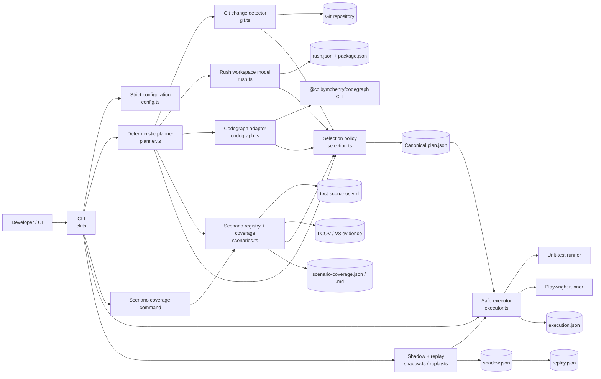
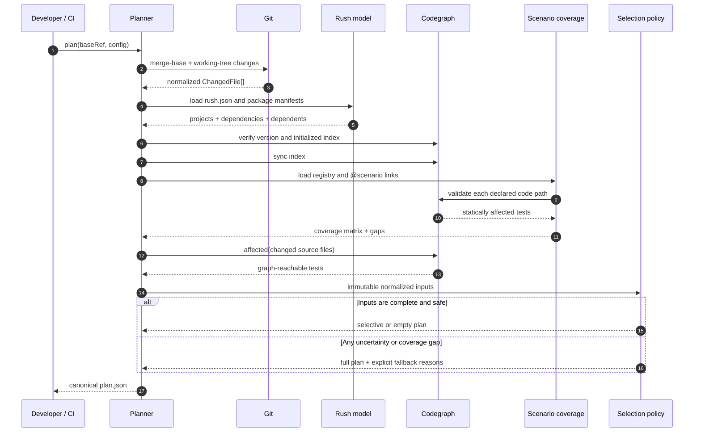
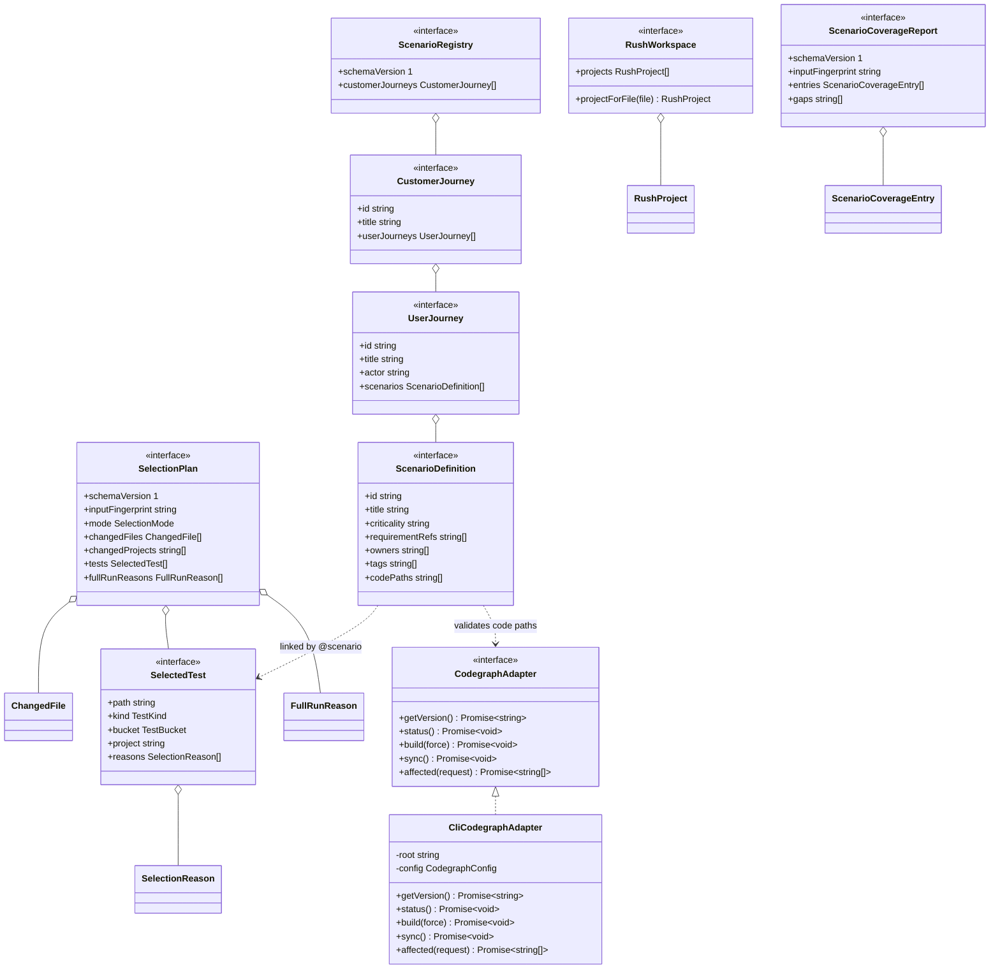
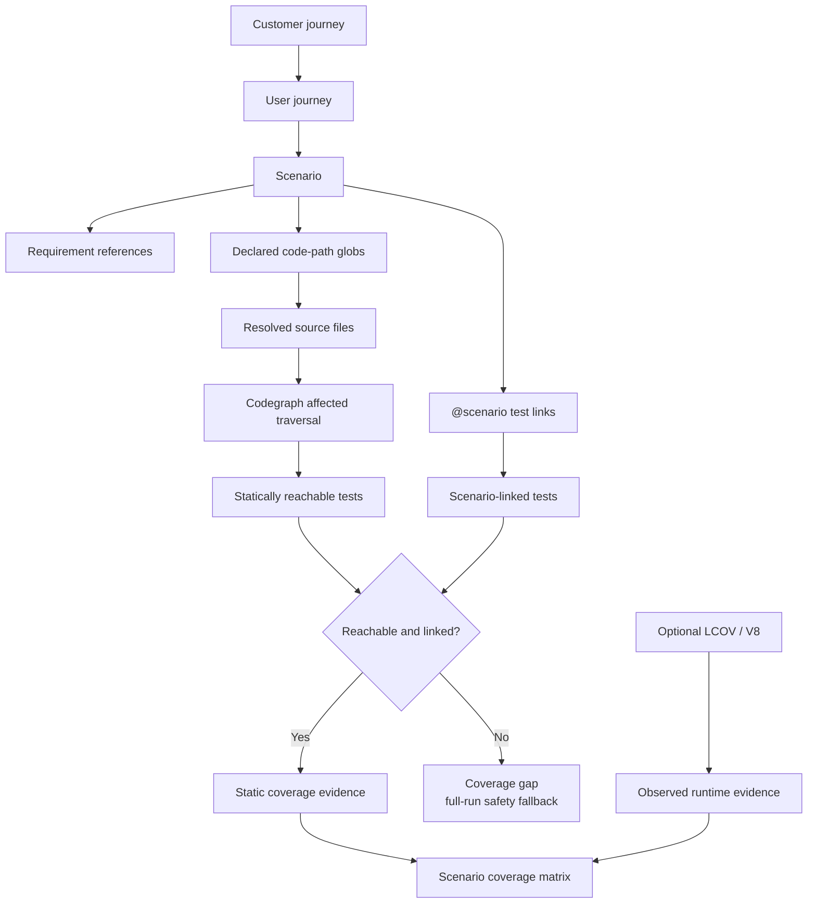

# playwright-codegraph

Deterministic, fail-open affected-test selection and scenario coverage for
Rush-based TypeScript repositories. File-level reachability is provided by the
required [`@colbymchenry/codegraph`](https://www.npmjs.com/package/@colbymchenry/codegraph)
CLI.

## Reliability contract

`playwright-codegraph` does not claim that networks, browsers, application code,
or tests can never be nondeterministic. It makes the **selection layer**
deterministic and safe:

- Identical Git, config, Rush, scenario, test-inventory, and codegraph inputs
  produce byte-identical `plan.json` output.
- Timestamps and durations are written only to execution records.
- Missing or stale graphs, incomplete Git history, invalid configuration,
  deleted/ungraphable files, unknown repository changes, malformed tool output,
  timeouts, and selection limits expand to a full run.
- A limit never silently drops affected tests.
- Every selected test and fallback has a stable reason.

## Capabilities

### Deterministic change analysis

- Protected three-dot merge-base calculation.
- Committed, staged, unstaged, renamed, deleted, and optionally untracked
  changes.
- Cross-platform path normalization and Git-ref option-injection protection.
- Rush project ownership plus dependency and reverse-dependent traversal.
- Canonical, versioned, byte-stable plans with an input fingerprint.

### Safe affected-test selection

- Required codegraph build, sync, status, version, and affected-test operations.
- Separate unit and Playwright test inventories and execution policies.
- Changed-test, graph-reachable, project-owned, direct-dependent, smoke, core,
  explicit-mapping, and scenario safety edges.
- Global triggers and project-wide expansion for inputs that a source graph
  cannot safely represent.
- Full-suite fallback for stale or missing graphs, incomplete history, invalid
  configuration, unknown files, coverage gaps, timeouts, malformed output, and
  selection or command-length limits.
- No random sampling, silent truncation, skipped affected tests, or shell-based
  command execution.

### Journey and scenario traceability

- Versioned `customer journey -> user journey -> scenario` YAML registry.
- Stable scenario IDs, actors, criticality, requirements, owners, tags, and
  declared code paths.
- `@scenario` links from unit and Playwright tests.
- Scenario-to-code-path validation using codegraph reachability.
- Scenario safety edges that select linked tests when changed code matches a
  declared scenario path.
- Duplicate IDs, unknown annotations, unresolved paths, scenarios without
  tests, and missing static links are reported as coverage gaps.

### Coverage evidence and reporting

- Static codegraph reachability, clearly labeled as declared/static evidence.
- Optional LCOV and V8 runtime evidence, clearly labeled as observed evidence.
- Canonical JSON selection, execution, scenario coverage, shadow, and replay
  artifacts.
- Human-readable Markdown scenario coverage matrix.
- `explain` diagnostics for a single changed file.
- Shadow execution where the full suite remains authoritative.
- Replay aggregation for retained shadow records and missed-failure detection.

### CI and package integration

- Cache-friendly full graph build and incremental synchronization.
- GitHub Actions and Azure Pipelines examples.
- Node.js 20/22 and Windows/Linux validation.
- Typed public library API in addition to the CLI.
- Strict unknown-key configuration validation.

## Architecture

### Component architecture



The boundaries are intentional:

| Component | Responsibility | Must not do |
|---|---|---|
| CLI | Parse commands, coordinate modules, write artifacts | Reimplement selection policy |
| Git detector | Produce normalized changed-file records | Decide which tests run |
| Rush model | Own projects and dependency/dependent relationships | Perform file-level graph analysis |
| Codegraph adapter | Validate and invoke the required external protocol | Apply test-selection policy |
| Scenario module | Parse traceability, annotations, and coverage evidence | Conflate static links with runtime execution |
| Selector | Combine deterministic reasons and apply fail-open rules | Execute child processes |
| Executor | Run exactly the plan with `shell: false` | Add or remove selected tests |
| Shadow/replay | Measure missed failures and fallback behavior | Override the authoritative full result |

### Deterministic planning sequence



### Public API class and interface diagram



### Traceability and evidence model



Static and runtime evidence deliberately remain separate. Static evidence proves
that a declared code path can reach a scenario-linked test through the indexed
dependency graph. Runtime evidence proves that an instrumented execution
observed code in a file. Neither is presented as proof that every branch or
requirement assertion was validated.

## Install

```bash
npm install --save-dev playwright-codegraph @colbymchenry/codegraph
```

Node.js 20 or newer is required.

Copy the examples:

```bash
cp node_modules/playwright-codegraph/playwright-codegraph.config.example.json playwright-codegraph.config.json
cp node_modules/playwright-codegraph/test-scenarios.example.yml test-scenarios.yml
```

## Define journeys and scenarios

```yaml
schemaVersion: 1
customerJourneys:
  - id: commerce
    title: Commerce
    userJourneys:
      - id: checkout
        title: Complete checkout
        actor: shopper
        scenarios:
          - id: checkout.card-payment
            title: Pay by card
            criticality: critical
            requirementRefs: [REQ-CHECKOUT-1]
            owners: [commerce]
            tags: [smoke]
            codePaths:
              - apps/store/src/checkout/**
              - packages/payments/src/**
```

Link a whole test file or a Playwright test title/tag:

```ts
// @scenario checkout.card-payment
test('shopper pays by card @scenario:checkout.card-payment', async ({ page }) => {
  // ...
});
```

Static coverage means that codegraph maps a declared code path to a test linked
to the same scenario. Runtime coverage means an optional LCOV artifact observed
executed lines in that file. Reports label these independently.

## Commands

```bash
# Long-running graph step, suitable for a cached build-pipeline job
npx playwright-codegraph graph build
npx playwright-codegraph graph sync
npx playwright-codegraph doctor

# Deterministic selection and execution
npx playwright-codegraph plan --base origin/main
npx playwright-codegraph run

# Measure safety: the full result is authoritative
npx playwright-codegraph shadow --base origin/main

# Aggregate retained shadow records and fail on missed failures
npx playwright-codegraph replay --records test-selection-history

# Scenario gate and optional runtime evidence
npx playwright-codegraph scenarios
npx playwright-codegraph scenarios --lcov coverage/lcov.info
npx playwright-codegraph scenarios --v8 coverage/coverage-final.json
```

Outputs default to:

- `test-selection-out/plan.json`
- `test-selection-out/execution.json`
- `test-selection-out/scenario-coverage.json`
- `test-selection-out/scenario-coverage.md`
- `test-selection-out/shadow.json`
- `test-selection-out/replay.json`

The scenario command exits with code 2 when the registry has coverage gaps.

## Configuration

See
[`playwright-codegraph.config.example.json`](./playwright-codegraph.config.example.json).
Runner commands use an executable and argument array and are always spawned
with `shell: false`. `{files}` is replaced by the selected paths. If the
resulting command exceeds `maxArgumentCharacters`, that runner uses its
`fullArgs` instead.

## CI model

Graph generation is intentionally separate because a full index can be
long-running:

1. Restore `.codegraph` using a key derived from the codegraph version, lockfile,
   Rush configuration, and selector configuration.
2. Run `graph sync`; run `graph build` when no valid index exists.
3. Generate and publish the plan and scenario matrix.
4. Execute the plan. Any unsafe planner input produces a full-run plan.

See [the GitHub example](./examples/github-actions-affected.yml) and
[the Azure Pipelines example](./examples/azure-pipelines.yml).

## Complete Rush example

[`examples/rush-two-package`](./examples/rush-two-package) is an independently
runnable repository with two Rush projects:

```text
@demo/store-app  --->  @demo/math-core
```

It includes package manifests, TypeScript builds, Vitest unit tests, a
Playwright customer journey, an HTTP test server, Rush configuration, scenario
traceability, codegraph configuration, and commands for graph build, planning,
explanation, scenario validation, and selected execution. CI validates the
example end to end by changing math-core and asserting that the deterministic
plan selects exactly three tests across both projects.

## Current boundaries

- Rush workspaces are the v1 workspace model.
- `@colbymchenry/codegraph` 1.6.2 or newer in the 1.x line is required.
- Scenario code paths are file globs. Symbol-level scenario declarations are not
  part of v1.
- Runtime evidence is optional unless `scenarios.requireRuntimeEvidence` is set.
- A static link proves dependency reachability, not that an assertion validated
  every branch in the file.

## License

MIT. See [third-party notices](./THIRD_PARTY_NOTICES.md).
